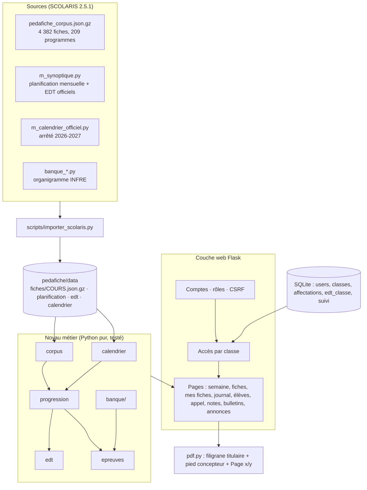

# Architecture — PédaFiche Bénin v2

## Flux pédagogique
Calendrier officiel (jours de classe) → planification mensuelle du cours (mois × matière : « U1 », « D1 SA1 », « SA3 Séq 1-4 »)
→ rattachement aux fiches (`progression.correspondances`) → tranche de la semaine → emploi du temps (créneaux × matière) → fiche du jour.
Les évaluations utilisent la même progression « jusqu'à la période » (mensuelle, trimestrielle, passage, CEP blanc).

## Modules web
`web/app.py` (comptes, accès par classe, fiches, progression, EDT, calendrier, évaluations) · `web/ens.py` (mes fiches, cahier journal, élèves, appel, carnet de notes, bulletins, annonces) · `web/securite.py` (blocage, mot de passe, audit, sauvegarde) · `notes.py` (moyennes, rangs, remédiation : Python pur testé) · `docx_export.py` (fiches Word).
Tables SQLite : users, classes, affectations, edt_classe, suivi, mes_fiches, eleves, presences, evals, notes, journal, annonces, annonces_lues, audit, tentatives.

## Sécurité
Mots de passe hachés (Werkzeug), jeton CSRF sur tout POST, cookie HttpOnly/SameSite, accès à une classe vérifié côté serveur
à chaque route (`classe_ou_403`) et fiche contrôlée contre le cours de la classe. Blocage après 5 essais faux, journal d'audit, HTTPS imposé par `PEDAFICHE_HTTPS=1` (cookie Secure + HSTS).
